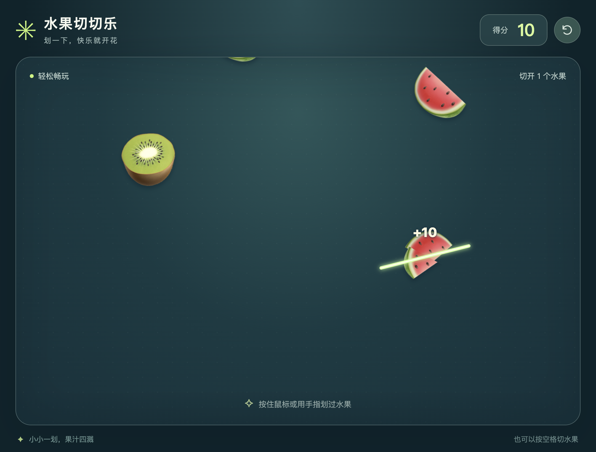

# 水果切切乐 · Fruit Slice

一个轻松的浏览器切水果小游戏。水果从上方落下，用鼠标或手指划过就能切开；没有炸弹，也没有漏掉水果的惩罚。

使用原生 HTML、CSS 和 JavaScript 编写，通过 Canvas 绘制。没有第三方运行时依赖，也不需要构建步骤。

## 游戏截图

以下截图来自游戏在真实浏览器中的运行画面。

开始画面：


切开水果时，会出现光轨、分瓣效果和计分提示：



## 本地运行

安装 Python 3 后，在项目目录运行：

```sh
python3 -m http.server 8000 --bind 127.0.0.1
```

打开 <http://localhost:8000>，点击「开始切水果」。也可以使用其他静态文件服务器。

请通过本地服务器访问，而不是直接双击 HTML 文件：游戏使用 JavaScript ES modules。部署到公网时请使用 HTTPS。

## 玩法

- 电脑：按住鼠标左键，划过水果
- 手机或平板：用手指划过水果
- 键盘：游戏区获得焦点后，按空格切一个可见水果；按 Esc 暂停或继续
- 每切开一个水果得 10 分，快速连续切开会显示连切提示
- 点击右上角的重新开始按钮，可以清零分数并重新开始
- 页面进入后台时会暂停，回来后点击「继续切水果」

## 项目结构

```text
index.html            页面结构与操作提示
style.css             桌面和移动端样式
game.js               Canvas 动画、碰撞检测与交互逻辑
tests/logic.test.cjs  无第三方依赖的逻辑测试
LICENSE               MIT 许可证
```

水果图案使用设备内置的 emoji 字体绘制，外观可能随系统和浏览器变化。项目不分发字体或第三方图片。

游戏不含账号系统、网络 API、分析追踪或持久化存储；刷新页面会重置进度。若浏览器支持 document.modelContext，游戏还会注册读取状态和重新开始两个可选工具；普通浏览器无需此功能也能玩。

## 测试

安装 Node.js 18 或更新版本后运行：

```sh
node tests/logic.test.cjs
```

测试在桌面和移动尺寸的模拟环境中覆盖线段碰撞检测、水果生成、切开与计分、重复计分保护、指针事件、键盘、重新开始、暂停与继续，以及可选工具的输入验证。这些是逻辑测试，不代替真实浏览器的视觉和触控测试。

## 部署

将 index.html、style.css 和 game.js 放在同一目录，交给任何支持 HTTPS 的静态网站托管服务即可。无需后端服务、环境变量或密钥。

## 许可证

本项目采用 [MIT 许可证](LICENSE)。使用、修改和再分发时，请保留版权及许可声明。
